# Neno the Radioactive Cat

Click Neno to make him follow your pointer. Click him again to make him return to his original spot, or grab him by the neck to drag him.

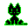 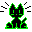 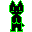 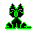 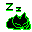 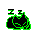 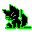 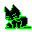 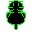 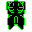 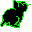 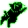 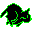 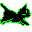 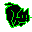 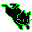 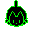 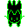 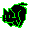 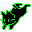 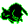 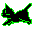 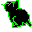 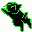 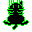 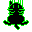 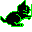 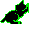 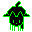 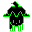 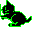 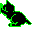

[Try Neno](https://zzolem.github.io/neno/)

Easily embed Neno on your website:

```html

<script defer src="https://zzolem.github.io/neno/neno.min.js"></script>
```

For variations, set the `alt` attribute on the `` tag (e.g. `alt="calico"`): white, black, gray, calico, robot, peach, colourful, earth, air, water, fire, spirit, rainbow, silversky, orange, ghetto, neon, pink, ghost, lucky, moka, usa, rose, blue, silver, kuramecha, kina, ace, spooky, holiday, valentine, marmalade, royal, mermaid, socks, dave, jess, mike, lucy, fancy.
